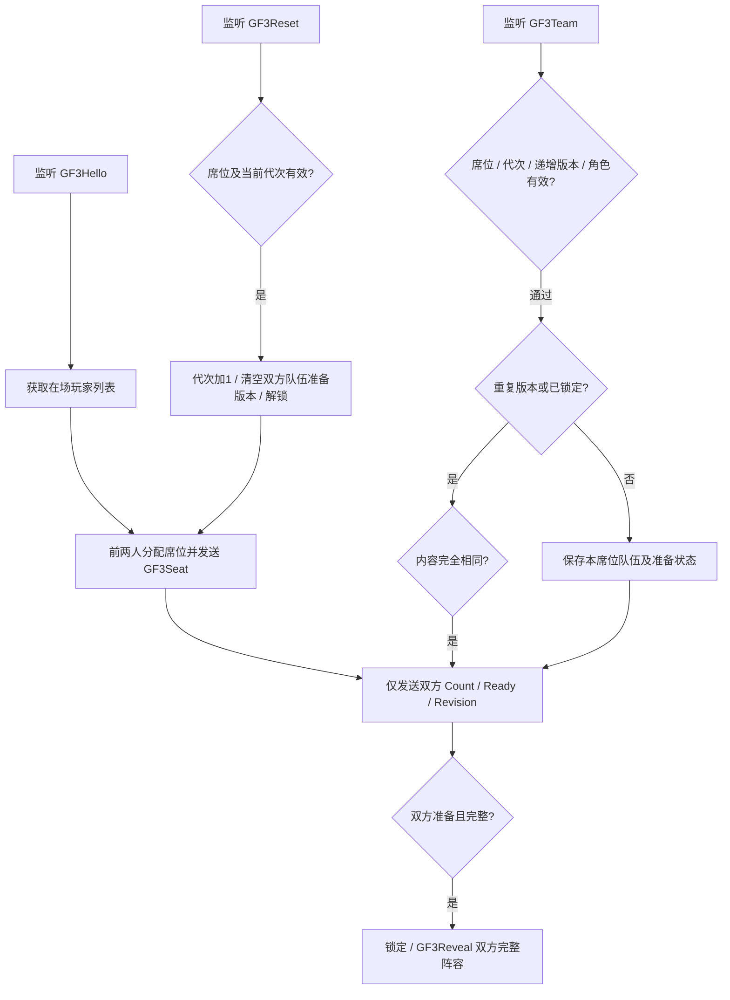

# 多角色对战：新节点图与 Lua

2026-10-12。**设计／实现：**新建独立 GF3 隐藏选人与准备协议；旧 GFV2 双人回滚图、传输信号与旧对战规则不改。首页新增模式选择，单人模式／联机模式下各有单角色对战／多角色对战。单角色继续走旧入口；多角色目前完成三人固定顺序选人、准备及阵容揭晓，未实现跨场换人战斗。

## 文件与安装范围

- `多角色选择_客户端.lua`：未压缩、未精简的完整客户端构建。用于替换测试工程客户端宿主 Lua，不同时启动两套客户端脚本。
- `GF3_客户端协议.lua`：独立懒加载模块源码，已包含在完整客户端中，不另挂载。
- `GF3_服务端逻辑参考.lua`：可执行离线服务端逻辑参考，已在双客户端协议测试中运行；不是千星服务端 Lua 挂载脚本。
- `GF3_Server_Node_Graph.json`：新节点、条件、设置、发送和执行连线规格，供编辑器搭建；**不是可导入原生 GIA**。条件表达式必须展开成比较／逻辑节点。节点 JSON 不能直接改扩展名导入。
- `manifest.json`：文件 SHA256。

本包没有新信号的官方监听／发送导出样例，不能编造内部资源 ID 或声称原生导入已通过。新建节点图命名“GF3 多角色隐藏选人与准备”，挂独立公共控制空实体；保留原 GFV2 图与全部旧变量。双方必须使用同版新 Lua；单角色模式仍使用旧 GFV2。

## 新信号（严格按此顺序，全部为整数）

|信号|方向|参数|
|---|---|---|
|GF3Hello|客户端→服务器|无|
|GF3Seat|服务器→客户端脚本|Slot、Epoch|
|GF3Team|客户端→服务器|Slot、Epoch、Revision、Role1、Role2、Role3、Ready|
|GF3Progress|服务器→客户端脚本|Epoch、Slot、Count、Ready、Revision|
|GF3Reveal|服务器→客户端脚本|Epoch、Revision1、Revision2、P1Role1、P1Role2、P1Role3、P2Role1、P2Role2、P2Role3|
|GF3Reset|客户端→服务器|Slot、Epoch|

角色编号保持原注册顺序：1雷电、2纳西妲、3芙宁娜、4绫华；0为空。不包含尚未接入角色。Ready：0未准备，1准备。队伍按1／2／3顺序；没有首发／中坚／大将文字。此版本没有战斗帧转发信号，不将 GF3 消息交给旧 GFV2Frames。

## 新图变量（都挂新控制实体）

`GF3_P1`／`GF3_P2` 为实体，初始为空。`GF3_Epoch` 整数初始1，`GF3_Locked` 布尔初始假。每方另建 `GF3_PxRole1`、`Role2`、`Role3`、`Count`、`Ready`（整数初始0），以及 `GF3_PxRevision`（整数初始−1）。x为1或2。变量实体输入一律连接“获取自身实体”，不要连接监听事件来源。

## 执行接线

1. Hello：列表长度≥1，列表索引0保存P1、直接向该实体发送Slot=1；长度≥2，索引1保存P2、直接发送Slot=2。Epoch读自身变量。不是按事件来源猜玩家。期间保持两玩家列表顺序稳定；不把第三人加入本会话。Hello每0.5秒重发，不重置准备状态，不设永久初始化门槛。
2. Team：按Slot=1／2进入各自保存分支。Epoch必须等于服务器值，Revision≥0且不小于对应已存版本，Ready只能0／1，角色0～4。空位只能在末尾，非零角色不得重复；Ready=1必须三位全满。所有比较失败出口结束，不写变量。
3. 重复版本：逐项比较角色、Ready及Revision；完全相同才重发状态。不允许同版本覆盖不同内容。Locked=真时只接受完全相同的重发；准备后的队伍不会被迟到包改写。
4. 新版本：依次设置该席位三个Role、Ready、Revision；Count按非零角色数计算，展开为判断与整数加法。向双方分别发送GF3Progress：只传数量与准备状态，**任何进度分支都不连接Role输出**。
5. 双方准备：至少两玩家、两Ready=1且有效队伍已保存，先Locked=真，再分别向P1、P2发送同一份GF3Reveal。双方读取各自Revision核对自己提交的阵容，再揭晓。Hello和相同Team重发时重新发送已锁定Reveal，避免回包丢失后卡住。
6. Reset：合法Slot、Epoch完全相等才处理。Epoch加1，清两方角色／数量／Ready为0、Revision为−1、Locked为假，再发新Seat及Progress。旧Epoch的Team／Reset全部丢弃，重复旧Reset不会多次加代次。

已核验的旧样例节点功能可用于新图：获取自身实体73、在场玩家列表248、列表长度142／144、列表取项128／130、双分支2、自定义变量读取50／实体特化52、设置22／实体特化24。新信号节点由编辑器创建实际绑定；端口按业务参数名连接，不能套旧信号内部ID。JSON中AND／OR／!=／条件取值表达式是接线表达式，不是单个原生节点。

## 操作、取消与验证边界

点头像只浏览，确认按钮才加入；三位满后显示准备，准备前返回撤回末位，顺序固定。单人模式由本地CPU独立选人。联机模式等待新GF3服务器席位；准备前对方仅显示数量／已准备，客户端不接收对方角色明细。取消联机准备采用Reset开启新选人代次，双方重新选择，防止取消与揭晓交错导致两端阵容不同；VS页收到新代次也返回选人。单人取消准备保留己方阵容。

身份路由沿用项目已确认的在场玩家前两席测试方式，没有新增发送来源身份验证，不能据此声称防作弊。隐藏指正常客户端准备阶段不展示且不接收对方角色明细；服务端持有双方阵容。

**模拟器：**`runtime/tests/team_protocol.py` 验证两客户端新信号、盲进度、取消／重置、完整揭晓、重发、非法角色／重复／空洞队伍、旧版本与旧代次拒绝，旧GFV2信号不进入新服务器逻辑。`runtime/tests/team_select.py` 验证手机／桌面触屏选人准备揭晓返回及菜单入口。**真机：**新节点尚未在编辑器搭建或双端实测，未验证官方导入。**待做：**多角色战斗换人、跨场同步、结算；本包不把选人完成当车轮战完成。

## 首页最新入口（优先于上文菜单层级）
首页：单人模式／联机模式／教学模式／训练模式／出招与系统／设置／退出游戏。前两项直接进入单角色对战／多角色对战；教学入口现有基础操作指引与训练；退出返回格斗开始界面。新GF3节点签名及旧GFV2隔离保持不变。
